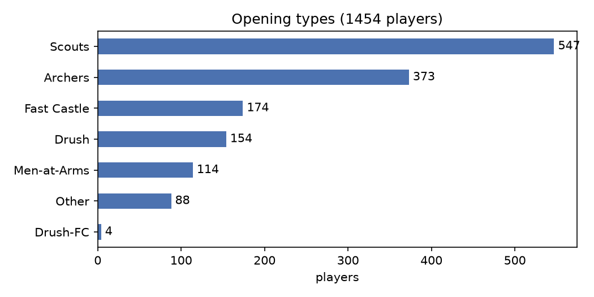
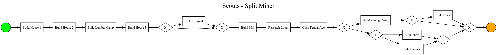
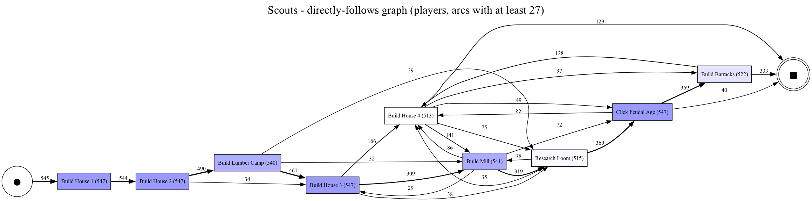
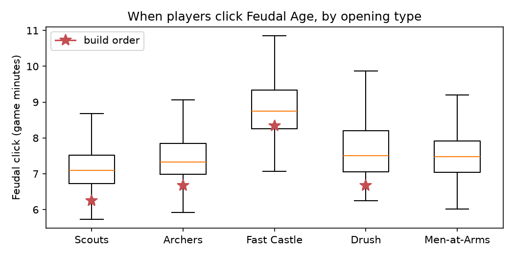
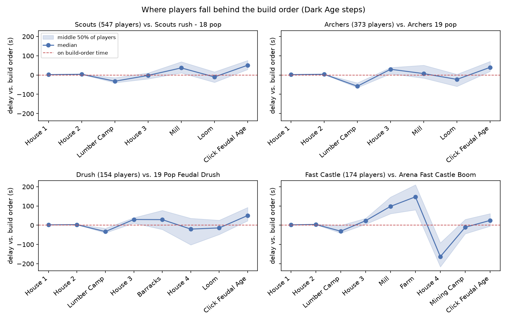

# Progress Check (first half)

State of the project for the progress check on 26 November 2026. Goal and
research questions: [VISION.md](VISION.md). All numbers come from the full
dataset (1,000 matches, 2,000 players); figures are in [progress/](progress/).

## Done

| Part | Course topic | Status |
|------|--------------|--------|
| Vision, persona, research questions | – | done |
| Data understanding and reliability check | event logs, data quality | done |
| Data preparation: case notion, opening cut, abstraction to milestones | data preparation, abstraction | done |
| Opening types (rule-based) | – | done |
| 4 build orders translated into milestones | normative models | done |
| RQ1: process discovery and variant analysis per opening type | discovery, variant analysis | done |
| RQ3 (first look): delay of each milestone against the build order | performance mining | done |

## Data: what we learned

- **Case = one player in one match** (`Session` object). Every event belongs
  to exactly one session. Timestamps are game time (villagers take exactly
  25 s, Feudal research 130 s).
- **Only player commands are reliable.** The game files contain player
  commands only; events triggered by the game (villager spawned, research
  started/finished) were reconstructed by the dataset authors and contradict
  real behaviour: in the 10-match sample, 12 of 19 players built Feudal-only
  buildings before the reconstructed Feudal arrival, and 30% of villager ids
  are shared by both players of a match.
- **Consequence:** we use player commands only and estimate the Feudal arrival
  as click + 130 s. Across all players, the first Feudal-only action comes a
  median 9 s after this estimate; only 46 of 1,747 players (2.6%) contradict
  it.
- **Analysis population: 1,454 of 2,000 players.** Excluded: 167 games ended
  in the Dark Age, 86 have no recorded Feudal click, 46 contradict the
  click + 130 s rule, 44 have no recorded houses, 81 start with extra
  villagers (civilization bonus), 132 play on water maps (some players fall
  in several groups).

## Data preparation

- **Opening** = every event up to the estimated Feudal arrival, including
  what players do while the research runs (the guides' "before Feudal"
  steps).
- **Milestone abstraction:** each opening becomes a short trace of player
  commands: houses 1–4, lumber camp, mill, mining camp, farm, barracks, dock,
  Loom, first militia, Feudal click (first occurrence each).
- **Opening types** by rules on the timing of key commands (castle click soon
  after Feudal → Fast Castle; Men-at-Arms upgrade right at Feudal →
  Men-at-Arms; militia before Feudal → Drush; first stable/archery range in
  Feudal → Scouts/Archers).
- **Reference models:** 4 generic build orders from
  [RTS Builds](https://github.com/CraftySalamander/rtsbuilds): Scouts 18 pop
  (Morley Games), Archers 19 pop (Morley Games), 19 Pop Feudal Drush (Hera),
  Arena Fast Castle Boom (Hera).

## Results so far

### RQ1: which openings do players play?

Scouts (38%) and Archers (26%) dominate, followed by Fast Castle (12%), Drush
(11%) and Men-at-Arms (8%). 123 of the 174 Fast Castle players are on Arena,
a map with pre-built walls.

| Opening | Players | Variants | Top variant | Variants for 80% | Split Miner fitness | Precision |
|---------|--------:|---------:|------------:|-----------------:|--------------------:|----------:|
| Scouts | 547 | 167 | 16% | 58 | 0.80 | 0.96 |
| Archers | 373 | 175 | 7% | 101 | 0.85 | 0.96 |
| Fast Castle | 174 | 105 | 7% | 71 | 0.89 | 0.94 |
| Drush | 154 | 126 | 3% | 96 | 0.81 | 0.98 |
| Men-at-Arms | 114 | 82 | 7% | 60 | 0.87 | 0.97 |

**Players follow the order of the build order.** The Split Miner model of
the Scouts players is the guide's order: House 1 → House 2 → Lumber Camp →
House 3 → (House 4) → Mill → Loom → Feudal click → Barracks.

The second most common Scouts sequence (16% of players) is exactly the
guide's order; the third (10%) only swaps the last two steps. The variety
comes mostly from *where* House 4 and Loom are placed.

### RQ3 (first look): where do players fall behind?

Players click Feudal Age **25–51 s later than the guides** (median: Scouts
7:06 vs. 6:15, Archers 7:20 vs. 6:40, Drush 7:31 vs. 6:40, Fast Castle 8:45
vs. 8:20).

- **Ahead at the start:** the lumber camp comes 30–60 s *earlier* than in
  the guides.
- **Behind from the mill on:** Scouts players are on time at House 3, 37 s
  late at the mill and 51 s late at the Feudal click. Fast Castle players
  are 98 s late at the mill and 148 s at the first farm.
- **The town center does not wait:** Scouts players click Feudal with a
  median of 19 villagers instead of the guide's 17. The delay is roughly the
  time of 2 extra villagers (50 s), so players keep training villagers until
  they can afford Feudal Age (500 food), which points to slower food
  gathering than the guide assumes. Food sources are not visible in the
  data, so this is an interpretation, not a measurement.
- **Systematic deviation:** 54% of Scouts and 63% of Archers players build
  House 4 *before* clicking Feudal; the guides build it during the research.
- Players research Loom a median ~1 min before clicking Feudal; the guides
  do both together.

## Second half (plan)

- **RQ2, conformance checking:** build orders as Petri nets; alignment
  fitness per player and the most frequent deviations; Declare rules for the
  flexible parts (e.g. *Precedence(Build Mill, Click Feudal Age)*).
- **RQ3:** full bottleneck analysis between milestones.
- **RQ4:** which deviations explain a late Feudal click (regression /
  decision tree), giving the must-follow and flexible steps.
- Validate the opening types with clustering; treat Fast Castle on Arena
  and on open maps separately.
